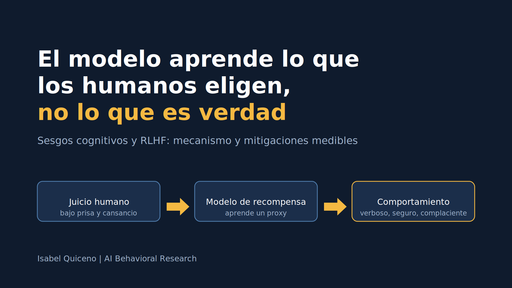

# El modelo aprende lo que los humanos eligen, no lo que es verdad

*Isabel Quiceno*

**Tesis.** El RLHF no alinea al modelo con "lo que los humanos quieren", sino con lo que los humanos eligen bajo las condiciones concretas en que juzgan. Esas condiciones (diseño de la tarea, incentivos, cansancio, composición del grupo) producen sesgos sistemáticos que el modelo aprende y explota. Como las condiciones se pueden diseñar, los sesgos también se pueden medir y mitigar.

## 1. El mecanismo: el juicio humano se convierte en proxy

El modelo de recompensa se entrena con comparaciones por pares y aprende a predecir qué respuesta elegiría un anotador, no cuál es más verdadera. Todo lo que se correlacione con la elección (longitud, tono seguro, coincidencia con la opinión del usuario) pasa a formar parte de la señal. Después, el modelo se optimiza contra ese proxy y tiende a explotarlo: es la ley de Goodhart aplicada al alineamiento. DPO omite el modelo de recompensa explícito, pero parte de los mismos pares de preferencias humanas, así que hereda los mismos sesgos.

## 2. Sesgos sistemáticos del anotador

- **Fluidez de procesamiento.** Un texto fluido, estructurado y seguro se percibe como más creíble, aunque no lo sea. La longitud se correlaciona fuertemente con las mejoras de recompensa en RLHF (Singhal et al., 2023). El modelo aprende a ser verboso y a presentar con aplomo incluso lo que inventa.
- **Preferencia por el acuerdo (sycophancy).** No es exactamente sesgo de confirmación: el anotador prefiere respuestas que coinciden con lo que el autor del prompt ya piensa, y a veces es la misma persona. Los datos de preferencia humana pueden favorecer respuestas aduladoras sobre respuestas veraces (Sharma et al., 2023).
- **Efectos de orden y anclaje.** En una comparación por pares, la primera respuesta leída ancla el juicio sobre la segunda.
- **Homogeneidad del grupo.** Si los anotadores comparten cultura, idioma y formación, sus puntos ciegos pasan al modelo como si fueran normas.
- **Desacuerdo descartado.** Al agregar por voto mayoritario se oculta el desacuerdo, que en temas ambiguos o éticos es información sobre qué casos son genuinamente discutibles.

## 3. Ruido que se vuelve sesgo

La fatiga y la presión de productividad (pago por tarea, tiempos objetivo) reducen la verificación factual. Eso es primero ruido: error aleatorio que degrada la señal. Pero bajo presión el anotador recurre a atajos, y el más barato es juzgar por fluidez. Así el ruido deja de ser aleatorio y refuerza el sesgo de la sección 2. La causa es estructural: el diseño de incentivos empuja hacia la heurística del menor esfuerzo.

## 4. Mitigaciones y cómo medirlas

El principio es diseñar el proceso para que el camino fácil sea también el correcto.

| Intervención | Qué hace | Métrica de éxito |
|---|---|---|
| Rúbricas separadas (veracidad, utilidad, estilo) y verificación previa a la comparación | Evita que la fluidez contamine el juicio de veracidad | Baja la preferencia por respuestas falsas pero elocuentes en preguntas de calibración |
| Control o registro de la longitud | Aísla el efecto de la extensión | Disminuye la correlación longitud–preferencia sin caer la calidad factual |
| Orden aleatorio de respuestas | Diluye el anclaje | Desaparece el sesgo de posición en la auditoría |
| Preguntas de calibración (respuesta elocuente con error plantado) | Mide y entrena la susceptibilidad a la fluidez | Tasa de error estable a lo largo de la sesión |
| Tiempo continuo limitado y revisión de métricas de productividad | Ataca la causa estructural del ruido | La precisión no se degrada con las horas |
| Prompts con afirmaciones falsas del usuario | Mide la sycophancy del modelo | Baja la frecuencia con que el modelo cede |
| Conservar el desacuerdo (p. ej., alfa de Krippendorff por categoría) | Marca los casos ambiguos en vez de forzar mayoría | El acuerdo se vuelve visible y orienta la revisión de guías |
| Diversidad del grupo, con su composición reportada | Reduce puntos ciegos compartidos | La composición se documenta junto al dataset |

## 5. Límites

Estas medidas reducen el sesgo, no lo eliminan, y cuestan tiempo y dinero. Sustituir humanos por un modelo juez (RLAIF) no resuelve el problema, lo traslada: el juez tiene sus propios sesgos, entre ellos preferir respuestas largas (Zheng et al., 2023). Tampoco hay evidencia comparativa clara de cuál de estas intervenciones pesa más; por ahora son hipótesis razonables y medibles, no resultados establecidos.

## Conclusión

El modelo de recompensa aprende lo que los humanos eligen, y lo que eligen depende de las condiciones en que juzgan. Cada una de esas condiciones se puede diseñar y medir. La psicología cognitiva aporta lo que ya sabe sobre cómo se forman los juicios bajo presión, y ese conocimiento se traduce en cambios concretos del proceso y en métricas que un equipo de ingeniería puede seguir.

## Referencias

- Casper, S. et al. (2023). *Open Problems and Fundamental Limitations of Reinforcement Learning from Human Feedback.*
- Sharma, M. et al. (2023). *Towards Understanding Sycophancy in Language Models.*
- Singhal, P. et al. (2023). *A Long Way to Go: Investigating Length Correlations in RLHF.*
- Zheng, L. et al. (2023). *Judging LLM-as-a-Judge with MT-Bench and Chatbot Arena.*
